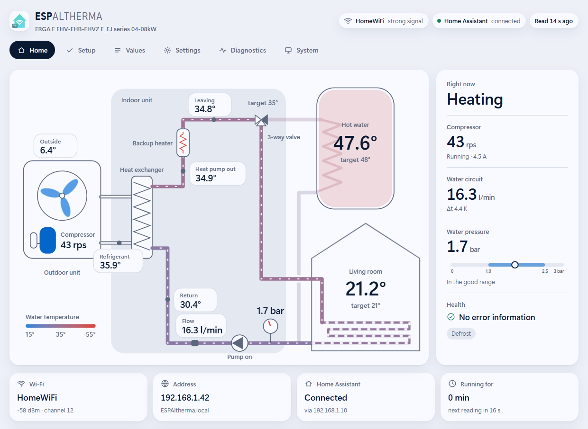
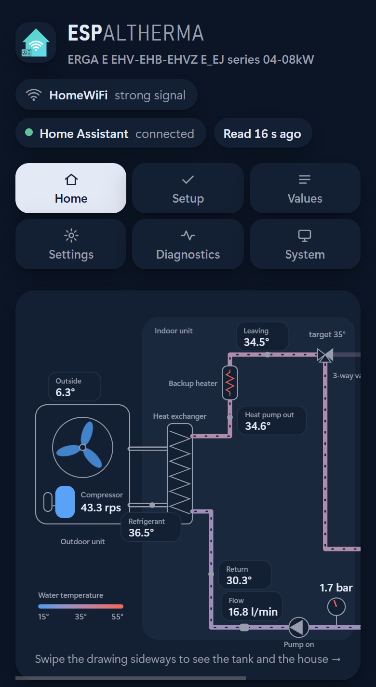
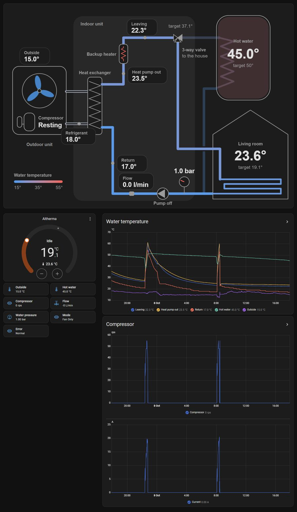
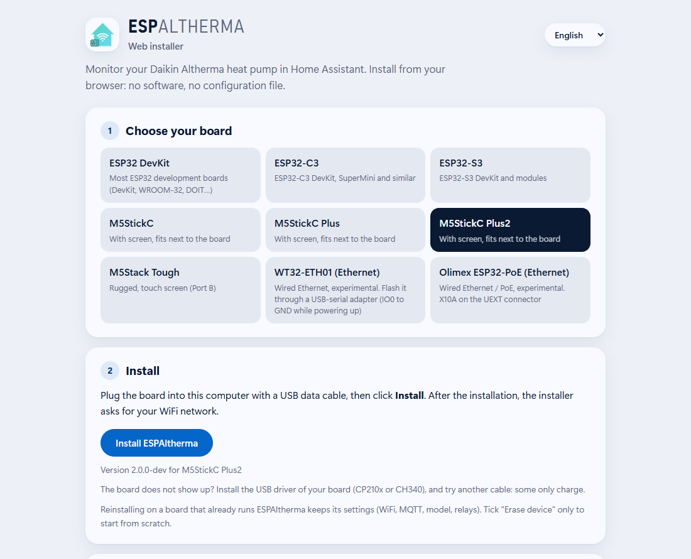
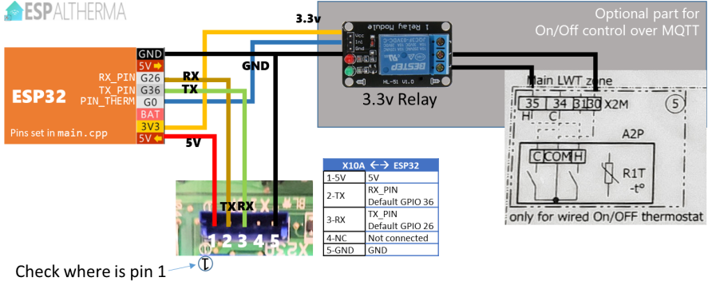
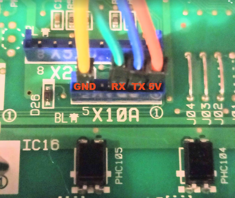
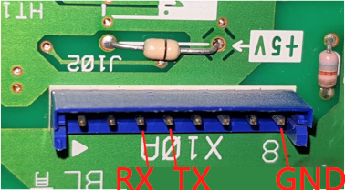
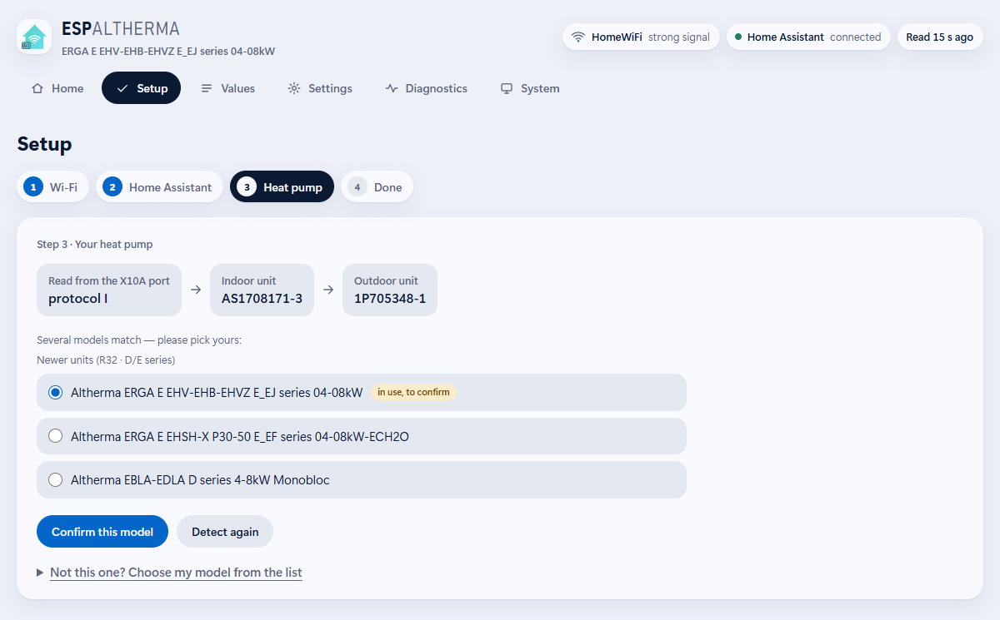
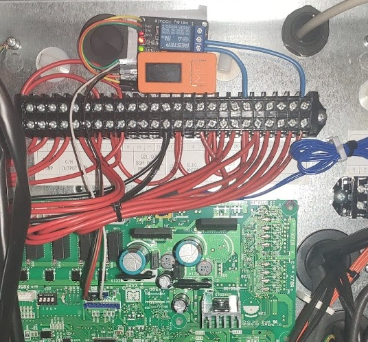
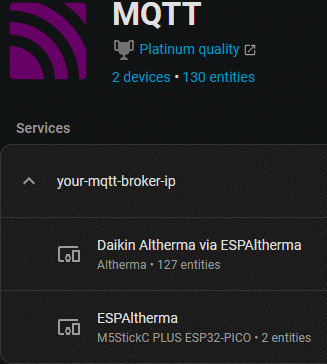

<hr/>

<p align="center">
<a href="https://github.com/raomin/ESPAltherma/actions/workflows/build.yml"></a>
&nbsp;

&nbsp;

&nbsp;
<a href="https://github.com/sponsors/raomin/"></a>
&nbsp;
<a href="https://www.buymeacoffee.com/raomin" target="_blank"></a>
</p>

<hr/>

**ESPAltherma turns an ESP32 board into a monitor for your Daikin Altherma heat pump.** It plugs on the diagnostic port of the unit and reads what the technician's tool reads: temperatures, flow, pressures, compressor, errors. Flash it from your browser, confirm your model, and your heat pump shows up in Home Assistant, with a live drawing of your installation. It works on the ROTEX and HOVAL Belaria units built on the Altherma too.

<p align="center"><b><a href="https://espaltherma.pages.dev/">➜ Install ESPAltherma from your browser</a></b></p>



<p align="center"></p>

And in Home Assistant, with the [ESPAltherma card](https://github.com/raomin/espaltherma-card):



## Features

- **Installs from the browser**: no software to install, no file to edit, nothing to compile.
- **Detects your heat pump** and reads its recommended values out of the box ([how it works](doc/how-it-works.md)).
- **A web interface**: the live drawing, a setup wizard, the choice of values, diagnostics and updates. In English, French, German, Italian and Spanish.
- **Home Assistant** finds it by itself (MQTT discovery), with the sensor names in your language. Any other MQTT consumer works too.
- **Controls** the heat pump as well: on/off through a relay, the Smart Grid inputs (relays too), and, on supported units, the hot water and leaving water targets.

Just an ESP32, no extra hardware. Wi-Fi, or wired Ethernet on the WT32-ETH01 and Olimex ESP32-PoE.

## Supported heat pumps

Every Daikin Altherma with the serial diagnostic port, which is about all of them:

- **Altherma 3** (R32): the split units (EHV/EHB/EHVZ, ETV/ETB/ETVZ, EBV/EBB/EBVZ, EAV/EAB/EAVZ), the EBLA/EDLA monoblocs, the ECH2O tanks (EHSH/EHSX, ETSH/ETSX, EBSH/EBSX), the GEO ground source units, the 3 kW EHFH/EHFZ.
- **Altherma LT** (R410A): EHVH/EHBH/EHVX/EHBX with an ERLQ outdoor unit, the EBLQ/EDLQ monoblocs, the Hybrid, the multi DHW tanks.
- **Altherma HT** (EKHBRD hydrobox) and **Altherma 4** (EPSK), with some values missing on their port, see [Troubleshooting](doc/troubleshooting.md).
- **Mini chillers** EWAA/EWYA and EWAQ/EWYQ.
- **Older units** (around 2010 or before) speaking the older S protocol, including the ROTEX HPSU.

The complete list is the [definitions](definitions) folder: one file per series. If yours is not there, ESPAltherma still reads it with the closest definition, and your report helps adding it (see [Step 3](#step-3-finishing-in-the-web-interface)). Daikin air conditioners also have a serial port, but with other protocols: ESPAltherma supports the Altherma one only.

# Getting started

## What you need

- A Daikin Altherma or Altherma-based heat pump (ROTEX, HOVAL Belaria...)
- An ESP32. *I recommend an M5StickC (Plus, Plus2): it has an integrated display, a magnet, fits well next to the board and is properly isolated. But any ESP32 of the list below works.* The ESP8266 is not supported anymore: keep [ESPAltherma 1.x](https://github.com/raomin/ESPAltherma/tree/v1) on it.
- A 5 pin JST EH 2.5 mm connector (or 4 Dupont wires M-F)
- A USB data cable (some cables only charge), and Chrome or Edge on a computer. 

*That's all!*

Supported boards: ESP32 DevKit (and most ESP32 boards), ESP32-C3, ESP32-S3, M5StickC, M5StickC Plus, M5StickC Plus2, M5Stack Tough, M5Stack Atom Lite, WT32-ETH01 and Olimex ESP32-PoE.

## Step 1: Installing the firmware

1. Open the **[ESPAltherma web installer](https://espaltherma.pages.dev/)** in Chrome or Edge, on a computer.
2. Choose your board.
3. Plug the board into the computer with the USB cable and click **Install ESPAltherma**. Pick the serial port of your board in the list the browser shows, then confirm.
4. When the installation is done, the installer asks for your Wi-Fi network: enter it. It then shows the address of ESPAltherma on your network.



- *The board does not show up in the list?* Install the USB driver of your board (CP210x or CH340), and try another cable.
- *Reinstalling on a board that already runs ESPAltherma 2* keeps its settings (Wi-Fi, MQTT, model, relays). Tick "Erase device" only to start from scratch.
- *No Wi-Fi step* (the ESP32-S3 and C3 boards come back as a new USB device after the flash), *or the network changed later?* The board opens a WiFi setup network **ESPAltherma-XXXX** (password `espaltherma`): join it with your phone and follow the page that opens. If no page opens, go to http://192.168.4.1.
- *WT32-ETH01:* it has no USB port. Flash it through a USB-serial adapter, with IO0 connected to GND while powering it up.

## Step 2: Connecting to the heat pump

1. Turn OFF your heat pump at the circuit breaker.
2. Unscrew your panel to access the main PCB of your unit.
3. Locate the X10A connector on the PCB. This is the serial port on the main PCB. If your installation includes a bi-zone module, the X10A port is occupied with a connector to the Bi-Zone module. You should then connect to the X12A port on the bi-zone module. Pins are identical to the X10A.
4. Using the 5 pin connector or 4 Dupont wires, connect the ESP as follows. Pay attention to the orientation of the socket.



| X10A | ESP32 |
| ---- | ----- |
| 1-5V | 5V - VIN *Can supply voltage for the ESP :)* |
| 2-TX | RX pin of your board (see below) |
| 3-RX | TX pin of your board (see below) |
| 4-NC | Not connected |
| 5-GND | GND |

The RX and TX pins of each board:

| Board | RX (to X10A pin 2) | TX (to X10A pin 3) |
| ----- | ------------------ | ------------------ |
| ESP32 DevKit, ESP32-S3 | GPIO 16 | GPIO 17 |
| ESP32-C3 | GPIO 4 | GPIO 5 |
| M5StickC, M5StickC Plus, M5StickC Plus2 | G36 | G26 |
| M5Stack Tough | G36 (Port B) | G26 (Port B) |
| M5Stack Atom Lite | G26 (Grove) | G32 (Grove) |
| WT32-ETH01 | GPIO 5 (RXD) | GPIO 17 (TXD) |
| Olimex ESP32-PoE | GPIO 36 (UEXT) | GPIO 4 (UEXT) |

> The pins can be changed later in the web interface (Settings → Heat pump connection).

Once connected, it looks like this:



**ROTEX units** have an 8 pin X10A which connects differently: pin 1 (on the left in the picture) is +5V. Some users reported that the 5V from their ROTEX was not strong enough to power their ESP32. In this case, use a USB charger to power the ESP32; the 5V from the X10A is then not needed.



Whatever you do, **make sure you keep a wire connecting the GND of the ESP32 to the GND pin of the X10A (even if you power your ESP32 with a USB charger)!!**

5. Cross check twice the connections and turn on your heat pump.

## Step 3: Finishing in the web interface

Open `http://espaltherma.local`, or the address shown by the installer (and on the screen of the M5). The **Setup** tab walks you through the rest.

1. **Heat pump.** ESPAltherma reads the heat pump and detects its model. Check it and click **Confirm this model**. If several models match, pick yours; if yours is not proposed, choose it from the full list ("Not this one?"). Until you confirm, only the values every candidate model reads the same way are published.

    The **Help others get their heat pump recognised** box, ticked by default, sends one report when you confirm, and one after each firmware update so the versions in use are known: the identification codes of your unit, the readings taken during the detection, the model and the firmware version. It lets ESPAltherma recognise the next unit of the same model without asking its owner. No network, MQTT or personal data is sent (the site keeps the country and city the report comes from, not the IP address); **See exactly what is sent** shows the report, and [this page](https://espaltherma-telemetry.pages.dev/) explains how reports are used. Untick it to send nothing.

    

2. **Home Assistant.** Click **Find my Home Assistant**: ESPAltherma looks for the MQTT broker on your network (usually the Mosquitto add-on of Home Assistant). Or enter its address, and a user and password if your broker needs one. **Test the connection**, then save. The sensors appear in Home Assistant automatically.

3. **Values.** The recommended values of your model are selected. Pick more (or less) in the **Values** tab, which also shows their current readings. *Try not to get everything: it would make a very big MQTT message.*

Everything is configured at runtime and kept across updates. To protect the settings, set an admin password in Settings → This device.

# Controlling the heat pump

Monitoring is the main job, but ESPAltherma can also act on the heat pump:

| What | How | In Home Assistant |
| ---- | --- | ----------------- |
| Turn the heating on and off | a relay on the *external thermostat* contact of the unit | `switch.altherma`, or a climate entity built on it |
| Smart Grid modes | two relays on the SG1 and SG2 contacts | the `Smart Grid` select |
| Stop the heat pump | the safety relay | `Altherma Safety` |
| Hot water and leaving water targets (experimental) | written through the diagnostic port, on supported units | two number entities |
| Power limit (experimental) | the installer's power limitation settings, written through the diagnostic port | a number entity in kW or A, and a switch |

Why not more? The settings you see on the user interface of the heat pump (the setpoints, the schedules, the curves) belong to that interface: it re-sends them to the hydro board every second, so anything written through the diagnostic port is overwritten at once. The relays act on the unit's own contacts instead, and the targets use the one case where the hydro board decides by itself (a weather-dependent setpoint). Everything else stays out of reach, see the [FAQ](#faq).

## On/off: the thermostat relay

A relay driven by ESPAltherma, wired as an *external On/Off thermostat*, lets you turn the heating of your heat pump on and off remotely. Connect the relay to a free GPIO of the ESP32 and set it in **Settings → Relays** (with the level that activates your relay). The switch `switch.altherma` then appears in Home Assistant; the MQTT topic is `espaltherma/POWER` (`ON` / `OFF`).

Refer to the schematic map of your heat pump to see where to connect the *external On Off thermostat*, and set the *type of thermostat* to *External thermostat* on the unit. The relay then takes priority over your thermostat, which goes to standby. On a ROTEX this connects to J16 pins 1 and 2, with RT switched ON in the Connection menu: heating is ON while the pins are connected, so use the NC (normally closed) contact of the relay.

Once installed, the setup looks like this (other users' installations are shown [in this issue](/../../issues/17)):



To drive it from a room temperature, declare a climate entity on the switch: see [Home Assistant](doc/home-assistant.md#a-climate-entity). More notes in [the details](doc/control.md#the-thermostat-relay).

## Smart Grid

ESPAltherma can drive the SG-Ready inputs of your heat pump. Set the pins of the SG1 and SG2 relays in **Settings → Relays**, then send one of the values 0 to 3 to the MQTT topic `espaltherma/sg/set`, or use the `Smart Grid` select in Home Assistant. The current mode is published on `espaltherma/sg/state`.

You need two relays to open and close the SG1 and SG2 contacts of your heat pump. On the M5StickC, M5StickC Plus and Plus2, use the Grove port next to the USB-C connector: **Smart Grid pin 1 = 32**, **pin 2 = 33**. The M5Stack relay units switch on a high signal: keep *Smart Grid relays active high* ticked. On other boards, any two free GPIOs, not the X10A ones. I found that the 5V supply pin of X10A provides enough power for my ESP32 and both relays, but your mileage may vary.

| sg/set | SG1 | SG2 | SG mode | What the heat pump does |
| ------ | --- | --- | ------- | ----------------------- |
| 0 | open | open | Normal operation | Works as if Smart Grid was not used |
| 1 | open | closed | Forced OFF | Heating and hot water are turned off. *Beware that your comfort may be negatively affected by this mode* |
| 2 | closed | open | Recommended ON | Raises the hot water and leaving water setpoints (the documentation says +5 °C, my tests show +6 °C) |
| 3 | closed | closed | Forced ON | Raises the hot water setpoint and uses full power to heat the tank (to 70 °C) |

*In mode 3 your heat pump will really be power hungry, so enable it only when electricity is cheap (ideally free), or be prepared for a high bill!* Smart Grid must be switched ON in the configuration menu of the heat pump, otherwise the contacts are not evaluated; the behaviour of mode 3 (ECO, Normal or Comfort) is set there too, and the ROTEX pins are in [the details](doc/control.md#smart-grid).

## The safety relay

A third relay can stop the heat pump, for instance wired to a safety contact of your installation. Set its pin in **Settings → Relays**; it appears as `Altherma Safety` in Home Assistant (topic `espaltherma/SAFETY`, `1` stops the heat pump, `0` releases it).

## Power limit (experimental)

The heat pump can be capped at a power (kW) or a current (A), the kind the installer set in the unit: ESPAltherma writes the installer's "power limitation" settings in the hydro board's working memory, continuous mode and limit 1, and the unit applies them within a cycle. For solar surplus or dynamic tariffs. Tick **Power limit** under **Settings → Experimental**: the home page gets a *Power limit* card, Home Assistant a `Power limit` number entity in the unit's kind and a `Power limit on` switch; on MQTT, a value on `espaltherma/power_limit/set` and `ON`/`OFF` on `espaltherma/power_limit/on/set`. Nothing is written in the unit's memory: a restart of the heat pump brings its own settings back, and ESPAltherma applies the limit again within two minutes. Under the compressor's minimum the unit stops it instead of running below, so the value has a floor (1 kW or 4 A). Mapped on the hydro board software 18002904 so far, tested on an EAVH16; the other boards show "not available" until mapped.

## Hot water and leaving water targets (experimental)

When a setpoint is *weather dependent*, the hydro board of the heat pump computes the target itself from its own curve, and ESPAltherma can write the wanted target into that curve: it holds whatever the weather, applies within a second, and is saved in the unit. This works for the hot water tank and for the leaving water of the main zone (the water sent to the floor or the radiators).

1. On the user interface of the heat pump, set the tank setpoint mode, or the leaving water setpoint mode of the main zone, to *weather dependent* ("loi d'eau" on a French interface).
2. In ESPAltherma, tick the corresponding box under **Settings → Experimental**.
3. The home page shows a *Hot water target* or *Leaving water target* card with the current target and the allowed range (the unit's own limits). Home Assistant gets a `Hot water target` and a `Leaving water target` number entity, with the MQTT topics `espaltherma/dhw_target/set` and `espaltherma/lwt_target/set`.
4. To give the unit its own curve back, click **Restore the unit's curve** on the card (ESPAltherma remembers the two points it found before its first write), press the matching button entity in Home Assistant, or send `restore` to the same MQTT topic.

The addresses written depend on the software of the hydro board, read from the unit at start: only the versions whose addresses are known are accepted, nothing is written on any other. Known so far: 18002904 (tested on a unit), and 17014006, 17019A04, 20002203, 20007904, 20017704, 20017705 and 22009C02 (from the boards' software, awaiting a first report each). If the card says "not available", please open an issue with the software version it shows. What the thermostat really aims for, the hysteresis, and the other things to know are in [the details](doc/control.md#hot-water-and-leaving-water-targets).

# Home Assistant

Once the MQTT broker is set ([Step 3](#step-3-finishing-in-the-web-interface)), Home Assistant creates a device "Daikin Altherma via ESPAltherma" with the values you selected, and an "ESPAltherma" device with the relays and the raw `sensor.althermasensors`. The entity IDs are built from the English labels (`sensor.espaltherma_discharge_pipe_tempr2t`), whatever the language of the names.



The [ESPAltherma card](https://github.com/raomin/espaltherma-card) brings the live drawing of the web page to Home Assistant, and builds a whole dashboard with the drawing, your thermostat, the key values and their history. Install it with HACS (custom repository `https://github.com/raomin/espaltherma-card`, type *Dashboard*), then create a dashboard whose configuration is just:

```yaml
strategy:
  type: custom:espaltherma
```

The rest is in [doc/home-assistant.md](doc/home-assistant.md): the discovery details and how to clear it, a climate entity on the thermostat relay, calculating the COP, the MQTT topics, one topic per value for OpenHAB and the like, and two boards on one broker.

# Updating

In **System → Firmware update**, click **Check for an update**: your browser looks for a newer release on the installer's site, downloads the file of your board and sends it to the board (the board itself never goes to the Internet for it). Without Internet access from the browser, upload the `-ota.bin` file of your board from the [latest release](https://github.com/raomin/ESPAltherma/releases) instead. Either way, if the new version cannot get back online, the board goes back to the previous one by itself. Running the [web installer](https://espaltherma.pages.dev/) again over USB works too, and keeps the settings.

You can also [build it yourself](doc/building.md) with PlatformIO.

# Troubleshooting

The **Diagnostics** tab of the web interface shows the event history (restarts and their cause, network drops, dated), the heat pump survey and the log. The log is also published on the MQTT topic `espaltherma/log`, and printed on the USB serial port (115200 bauds).

**No heat pump answered, 'Time out! Check connection', 'Wrong CRC on registry...'**: the communication is wrong. Usual suspects, in order: an un-connected GND (whatever you do, the GND of the ESP should always be connected to the GND of the Altherma, even when the ESP is powered by USB); a faulty Dupont cable, a VERY COMMON cause, so change it; RX and TX swapped, or other pins than the ones set in Settings → Heat pump connection. Once fixed, click **Detect again** in Setup → Heat pump.

More in [doc/troubleshooting.md](doc/troubleshooting.md): the board restarting or dropping off the network, the note on the 5V and 3.3V levels, and what to expect on the older S protocol units, the Altherma 4 and the Altherma HT.

# Coming from ESPAltherma 1.x

Install ESPAltherma 2 with the web installer, over USB: your `setup.h` is not read anymore, everything is entered in the web interface. If you used an English definition file, Home Assistant keeps the same device and entity IDs, so your history, dashboards and automations keep working for the values you select again (except the error and thermostat values, now told apart between the outdoor and the indoor unit). If you used a translated one, the entity IDs change: [doc/upgrading-from-1.x.md](doc/upgrading-from-1.x.md) explains what to do. ESPAltherma 1.x stays on the [v1 branch](https://github.com/raomin/ESPAltherma/tree/v1).

# FAQ

## Great! I can now monitor my heat pump! Can I change the configuration values too?

Mostly not: the user interface of the heat pump owns the setpoints it shows and re-sends them every second, so the diagnostic port cannot change them. ESPAltherma goes around it where it can: the [thermostat relay, the Smart Grid inputs and the targets](#controlling-the-heat-pump). The dedicated issue is [#1](https://github.com/raomin/ESPAltherma/issues/1). If you want to configure your heat pump from a microcontroller, you can interact with the P1P2 serial protocol (the one of the digital thermostats) using the [nice work on P1P2Serial](https://github.com/Arnold-n/P1P2Serial) of Arnold Niessen.

## Where can I get more info on the protocol used?

It took quite some time to reverse engineer the protocol. If you're interested, I documented my findings [here](doc/Daikin%20I%20protocol.md), and [how ESPAltherma tells the models apart](doc/how-it-works.md).

## Is it safe? Can I break my machine?

It is as safe as interacting with a serial port can be. Pretty safe if you are a bit careful. Use is entirely at your own risk. No liability.

## Why not using the Daikin LAN adapter?

Of course you can probably achieve the same with the BRP069A62 adapter. However, it is expensive, not wifi and less fun than doing it yourself :)

## I selected a value but it is always returning 0 (or OFF)

The definitions contain values for a range of products. It is possible that some of the values are not implemented in your specific heat pump. The Values tab shows the current reading of each value: use it to see which ones your unit really reports. If it says 'conv XXX not avail.' it is that I did not implement this specific conversion of value. If you need this value, create an issue and I'll implement it.

## What is the meaning of this value?

Some times the names of the values can be cryptic. Sometimes, the names are more informative on other models: you can look for the registry in another model's definition, this can give you a hint. Eg.: in one file `0x62,15` is `"Pressure sensor"`, in another `0x62,15` is `"Refrigerant pressure sensor"`. I'm not an expert in heat pumps, so I don't understand all possible values. Collectively however, I'm sure that we can understand a lot: [a page in the WIKI](https://github.com/raomin/ESPAltherma/wiki/Information-about-Values) collects comments on the values, add yours!

# Contributing

Every contribution to this project is highly appreciated! Don't fear to create issues to report possible bugs or feature request. Pull requests which enhance or fix ESPAltherma are also greatly appreciated for everybody!

The values of each heat pump model are described in the definition files of the [definitions](definitions) folder. The firmware's catalog of models is generated from them when building (`scripts/gen_catalog.py`).

If this project is useful to you, and if you want, <b>[you can buy me a beer](https://www.buymeacoffee.com/raomin)</b>! It feels good and really helps improving ESPAltherma. Thanks :)

You can also [sponsor this project](https://github.com/sponsors/raomin/) (ie regular beers :)) and become an official supporter of ESPAltherma and get your badge on this page!

## ❤ Sponsors ❤

<a href="https://github.com/DasUrmel">@DasUrmel (Thorsten Seidel)</a><br/>
<a href="https://github.com/lotterbach1">@lotterbach1</a><br/>
<a href="https://github.com/vtxray">@vtxray</a><br/>
<a href="https://github.com/sponsors/raomin/"><b>You..?</b></a><br/>

With thanks to the former sponsors: <a href="https://github.com/gerione">@gerione</a>, <a href="https://github.com/kloni">@retrack (Antoine Coetsier)</a>, <a href="https://github.com/EvertJob">@EvertJob (toppe)</a>, <a href="https://github.com/FusisCaesar">@FusisCaesar</a>, <a href="https://github.com/Mychel60">Michael</a>.

# License
ESPAltherma is licensed under 
