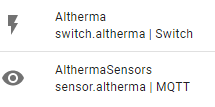
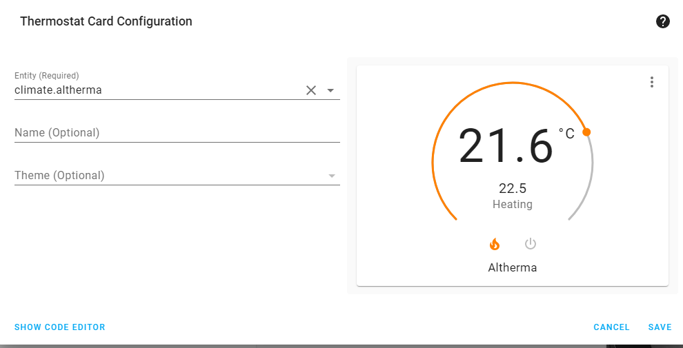

# ESPAltherma and Home Assistant

ESPAltherma integrates with Home Assistant through [MQTT Discovery](https://www.home-assistant.io/integrations/mqtt/#mqtt-discovery): once the broker is set in the Setup tab, the sensors appear by themselves. The [ESPAltherma card](https://github.com/raomin/espaltherma-card) then draws your installation and builds a dashboard (see the [README](../README.md#home-assistant)). This page has the details.

## Device discovery

On successful startup, ESPAltherma generates one distinct device "Daikin Altherma via ESPAltherma" and two entities under the device "ESPAltherma" under the MQTT integration in Home Assistant:


The "Daikin Altherma via ESPAltherma" device contains all the values you selected, while the "ESPAltherma" device contains two more low-level entities:



- `sensor.althermasensors` holds the sensor values as attributes.
- `switch.altherma` activates the thermostat relay, when one is set.

ESPAltherma publishes the device discovery JSON on the MQTT topic `homeassistant/device/espaltherma-mqtt-discovery/config` for Home Assistant to pick up. It makes the devices as specific to their unit as possible. Other characteristics:

- Their name is the label name, in the language chosen in Settings → This device, e.g. "Discharge pipe temp.(R2T)".
- Their entity ID is `sensor.espaltherma_` followed by a lowercase, alphanumeric only conversion of their English labels with spaces replaced by underscores. For example: "Discharge pipe temp.(R2T)" becomes `discharge_pipe_tempr2t`. The IDs stay the same whatever the language.

To clear the configuration, for example after adding or removing some sensor, publish an empty, retained message to `homeassistant/device/espaltherma-mqtt-discovery/config`.

## A climate entity

To control heating through the On/Off switch, declare a Climate (aka thermostat) entity monitoring a temperature sensor.

```yaml
climate:
  - platform: generic_thermostat
    name: Altherma
    heater: switch.altherma
    target_sensor: sensor.temproom1
    min_temp: 15
    max_temp: 25
    cold_tolerance: 0.5
    hot_tolerance: 0.5
    min_cycle_duration:
      minutes: 30
    away_temp: 15
    precision: 0.1
```

Then, add a Thermostat card somewhere (the ESPAltherma card picks a climate entity named Altherma by itself):



## Calculating COP

The COP (coefficient of performance) is the heat delivered by the heat pump divided by the electricity it uses. ESPAltherma gives the heat side: the water flow and the temperatures of the water leaving and coming back. For the electricity side, the most accurate is an external power meter on the supply of the heat pump (a Shelly, a DIN rail meter...) that reports to Home Assistant. Many older heat pumps don't report their own consumption at all.

**Heat delivered**, in kW: flow (l/min) × 0.06 (to m³/h) × 1.16 (kWh per m³ and °C) × (leaving − return temperature). This needs the flow: if your model doesn't report "Flow sensor (l/min)", you need a heat meter.

In `configuration.yaml`:

```yaml
template:
  - sensor:
      - name: "Heat pump heat output"
        unique_id: espaltherma_heat_output
        unit_of_measurement: "kW"
        device_class: power
        state_class: measurement
        state: >
          
          
          {{ [flow * 0.06 * 1.16 * dt, 0] | max | round(2) }}
      - name: "Heat pump COP"
        unique_id: espaltherma_cop
        state_class: measurement
        state: >
          
          
          {{ (heat / power) | round(2) if power > 0.05 else 0 }}
```

- Replace `sensor.my_heat_pump_power` with your power meter, in W (drop the `/ 1000` if it reports kW).
- Check the entity ids in Settings → Devices & services → Entities: they come from the English labels and can differ a bit between models.
- If the meter also powers the backup heater, use the water after it: `sensor.espaltherma_leaving_water_temp_after_buh_r2t`.
- During a defrost the heat output is negative: it shows 0.

**COP of a day.** The instant COP jumps around (start, defrost, hot water). Over a day, divide energies instead: create an *Integral* helper (Settings → Devices & services → Helpers → *Create helper* → *Integral sensor*, method *Left*) on "Heat pump heat output", and one on your power meter, unless it already gives kWh. Put a daily *Utility meter* helper on each, and divide the two in a template like the one above.

**Without a power meter**, you can estimate the power from the inverter current: `sensor.espaltherma_inv_primary_current_a` × `sensor.espaltherma_voltage_nphase_v` (or × 230 if your model doesn't report the voltage), on single-phase units. It leaves out the water pump and the electronics, so the COP comes out a bit high.

## MQTT topics

Every topic starts with the base topic, `espaltherma` unless you change it in Settings → MQTT output.

| Topic | |
| ----- | - |
| `espaltherma/ATTR` | All the values, as a JSON message, plus `WifiRSSI`, `FreeMem`, `Uptime` and `IP` (the board's address) |
| `espaltherma/LWT` | `Online` / `Offline` |
| `espaltherma/log` | Log messages |
| `espaltherma/detect` | The detection report: identification codes of your heat pump, every registry read once, detected model. Send anything to `espaltherma/detect/run` to read it again |
| `espaltherma/POWER`, `espaltherma/STATE` | Thermostat relay: `ON` / `OFF` |
| `espaltherma/sg/set`, `espaltherma/sg/state` | Smart Grid mode, `0` to `3` |
| `espaltherma/SAFETY`, `espaltherma/SAFETY_STATE` | Safety relay: `1` stops the heat pump, `0` releases it |
| `espaltherma/dhw_target/set`, `espaltherma/dhw_target/state` | Hot water target in °C (experimental, see [the targets](control.md#hot-water-and-leaving-water-targets)); `.../attributes` carries the effective target and the ceiling |
| `espaltherma/lwt_target/set`, `espaltherma/lwt_target/state` | Leaving water target of the main zone in °C (experimental, same section) |

Settings → MQTT output can also publish one topic per value, use the JSON table format of ioBroker, and send the on/off values as `1`/`0` (for EmonCMS and the like; Home Assistant follows it).

**One topic per value** (OpenHAB and others): tick **One topic per value** in Settings → MQTT output. Each value is then also published in `espaltherma/OneATTR/[valuename]`, e.g. `espaltherma/OneATTR/Boiler Heating Target Temp.` (the prefix can be changed there). The value names are the labels shown in the Values tab.

**Two boards on one broker**, for instance one on the indoor unit and one on the outdoor unit of an Altherma HT, need different base topics, such as `espaltherma-idu` and `espaltherma-odu`: the Home Assistant entities of a board then start with its base too (`sensor.espaltherma_odu_...`), on a device of their own. The card looks for the `espaltherma_` entities: keep the default base on the board you want in it, or give the card the other board's prefix (`prefix: espaltherma_odu`), and point single values at the other board with its `entities` option. The one-topic-per-value prefix is a setting of its own: change it too if both boards use that option.

**Watching the messages:** in Home Assistant, Settings → Devices & services → MQTT → Configure → Listen to a topic `espaltherma/#`, or:

```bash
$ mosquitto_sub -v -t "espaltherma/#"
```
