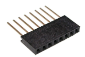

# Troubleshooting

## Where to look first

The **Diagnostics** tab of the web interface shows the event history (restarts and their cause, network drops, dated), the heat pump survey and the log. The log is also published on the MQTT topic `espaltherma/log`, and printed on the USB serial port (115200 bauds). You can see the MQTT messages in Home Assistant through Settings → Devices & services → MQTT → Configure → Listen to a topic `espaltherma/#`, or with:

```bash
$ mosquitto_sub -v -t "espaltherma/#"
```

## No heat pump answered, 'Time out! Check connection', 'Wrong CRC on registry...'

This means that the communication is wrong. Usual suspects:

1. Un-connected GND: whatever you do, the GND of the ESP should always be connected to the GND of the Altherma. So, if you power your ESP with a USB charger (or your computer), make sure you also connect the GND from the ESP to your GND of the Altherma.
2. If not GND, then it's always the Dupont cable. A faulty dupont cable is a VERY COMMON cause of issue. You can have a perfectly looking cable, they are not the best to do connection on the X10A connector (although much more common than an EH JST 5pin). So, change your cable. You can also use a common 2.54 female long header, plug it to the X10A connector and then your dupont cable to the long pins of the header.

3. RX and TX swapped, or other pins than the ones set in Settings → Heat pump connection.

Once fixed, click **Detect again** in Setup → Heat pump.

## The board restarts or drops off the network

Open Diagnostics → Event history: it tells why the board restarted (power, crash, watchdog, Wi-Fi lost for too long...). A weak 5V from the X10A is a common cause: on M5 boards, the supply voltage is shown in the Values tab. Power the board from a USB charger in that case (and keep the GND wire).

A weak Wi-Fi signal is the other one: the System tab shows it in dBm. An ESP32 board with an external antenna connector, or a repeater near the heat pump, usually fixes it. ESPAltherma moves to the strongest access point of your network by itself, opens its setup network when the Wi-Fi is gone, and goes back to the previous firmware if an update cannot get back online.

## Note on voltage

The serial port of X10A is TTL 5V, where the ESP32 is 3.3V. Your ESP32 might not be 5V tolerant. If you want to play it safe, you should use a level shifter to convert Daikin TX - RX ESP line from 5V to 3.3V.

In practice, I had no problem connecting an ESP32 without level shifters. I also had no issue powering the ESP32 from the 5V line of the X10A. On my Daikin Altherma, 5V is provided by a 7805 with a massive heat sink, plus, there are not many clients for it on the board and the ESPAltherma running on my ESP32 consumes 70ma.

Some users reported that a ROTEX did not have a stable 5v that could be used to power the ESP32. If so, you would need to rely on an external 5V power supply (eg a regular USB charger) to power the ESP32.

## Older heat pumps (S protocol)

Older Altherma heat pumps (around 2010 or before) use the older S protocol. ESPAltherma detects it by itself. If it does not, choose the `PROTOCOL_S` (or `PROTOCOL_S_ROTEX`) model from the full list in Setup → Heat pump.

## Altherma 4 (EPSK outdoor units)

The X10A connector is on the A1P switch box of the indoor unit, and the unit answers like the R32 generation, so ESPAltherma recognises it (its hydro board is the same for every model) and reads the outdoor unit, the leaving water, the flow and the pressure. Some values are not on this port: the return water is measured in the outdoor unit ("Inlet water temp. (water heat exchanger)"), and the room and hot water tank temperatures are read by the user interface. The Altherma 4 also has an official local interface, Modbus TCP on the indoor unit's RJ45 port (through the HomeHub, or directly with recent firmware), which gives those values. Reports from Altherma 4 owners are welcome: the definition was built from what owners read, not from a Daikin definition.

## Altherma HT (EKHBRD hydrobox)

The high temperature Altherma (an EKHBRD011-016 hydrobox on an ERRQ or ERSQ outdoor unit) has no X10A. Its service port is X41A on the hydrobox's inverter board (A5P on single phase units, A4P on three phase ones), with the same five pins as X10A (V+, TX, RX, NC, GND). The hydrobox answers the values of its own refrigerant stage (R134a), not the indoor unit ones, and it is recognised by the shape of its replies. Two definitions read the same board: "Altherma(HT EKHBRD-ERRQ series 11-16kW)", chosen automatically, gives the low pressure, the compressor frequency, the expansion valve, the 4-way valve, the switch box fan and the inverter currents; "Altherma(HT EKHBRD-ERRQ series 11-16kW protocol S)", chosen from the list, uses the older protocol on the same port and gives both pressures and the discharge and liquid temperatures instead. Pressures are converted to R134a saturation temperatures. Mapped by owners on [issue #95](https://github.com/raomin/ESPAltherma/issues/95).

## A value is always 0 (or OFF)

The definitions contain values for a range of products. It is possible that some of the values are not implemented in your specific heat pump. The Values tab shows the current reading of each value: use it to see which ones your unit really reports. If it says 'conv XXX not avail.' it is that I did not implement this specific conversion of value. If you need this value, create an issue and I'll implement it.
